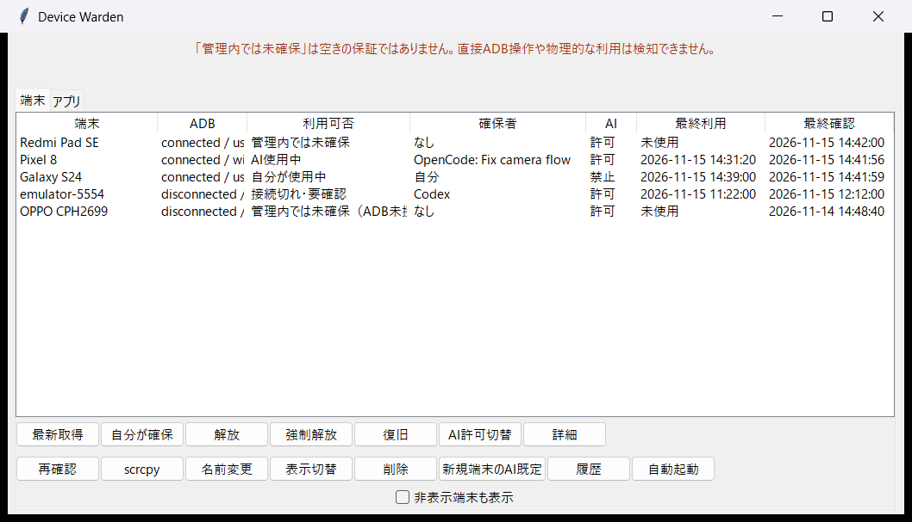
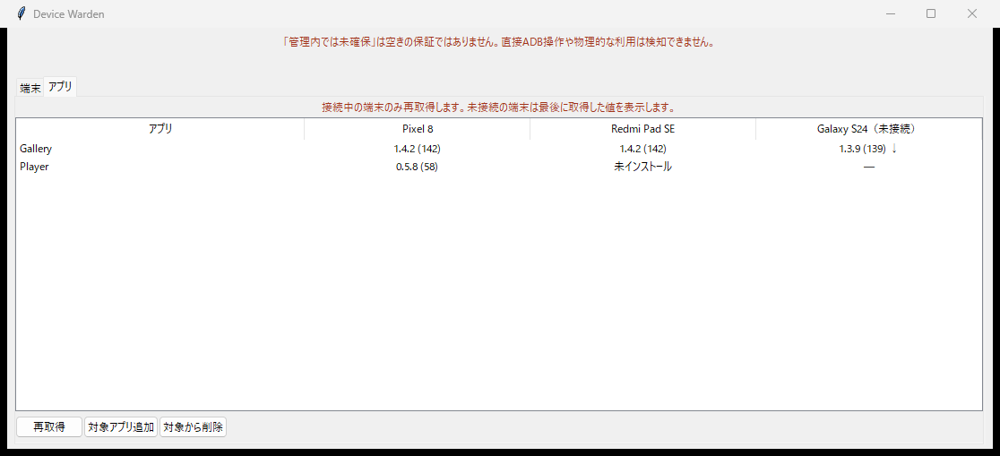

# Device Warden

**触る前に、そのAndroid端末を自分が使ってよいか分かる。**

Device Warden は、Windows のタスクトレイに常駐する軽量な端末管理ツールです。手元のAndroid端末・エミュレーターを、人間と複数のAIコーディングエージェントの間で取り合いにならないよう調整します。誰がどの端末を確保しているか、接続されているか、AIが使ってよいかを一覧で判断できます。

<p align="center">
  
</p>

<p align="center">
  
</p>

```text
端末                ADB                利用可否              確保者
Redmi Pad SE        connected / usb    管理内では未確保      —
Pixel 8             connected / wifi   AI使用中              OpenCode / ses_example…
Galaxy S24          connected / usb    自分が使用中          自分
emulator-5554       disconnected       接続切れ・要確認      Codex
OPPO CPH2699        disconnected       管理内では未確保（ADB未接続）  —
```

## なぜ必要か

Windows に複数の実機とエミュレーターがつながっていると、AIエージェントと人間が同じ端末を取り合って、次の問題が起きます。

- **衝突** — 2つのエージェントが同じ端末を選び、片方のテスト結果を静かに壊す。
- **誤解** — 抜けている端末が空いているとは限らず、ADBでつながっている端末も暇とは限らない。

Device Warden は端末ごとに同時1件のリースをローカルのSQLiteに記録し、その状態をトレイUIと、認証付きの小さなCLI/HTTP APIで公開します。

## 主な機能

- **リースBroker** — `claim` / `heartbeat` / `release` / `list` を提供。端末あたり有効なリースは1件だけで、確認してから取得するのではなくDB制約で排他する。
- **接続状態の追跡** — `connected` / `disconnected` / `unauthorized` / `unknown`。切断や再起動でリースを勝手に解放せず、**要確認**へ移す。
- **独立した3つの軸** — ADB接続、リースの所有者、AI利用ポリシー（許可/禁止）は互いを上書きしない。
- **人間とAIの区別** — OpenCode はセッションIDに加えてタイトル・プロジェクト・作業ディレクトリを表示。一覧の確保者欄には `OpenCode: セッション名` のように表示し、どのセッションが保持しているか分かるようにする。Codex や Command Code などはツール名で表示し、同じツールの複数ワーカーも個別のリースで区別する。
- **OpenCodeプラグイン** — 確保時に実際のセッションIDを渡し、30秒ごとに自動でheartbeatを送る。解放は明示操作のみで、セッション終了では解放しない。
- **ADBの仲介** — リース経由の `adb` は対象を `-s <serial>` で固定し、許可するサブコマンドを限定する。
- **監査ログ** — 確保・解放・強制解放の所有者を記録。`device-warden audit` またはGUIの「履歴」で確認できる。
- **トレイ中心の操作** — 状態で色が変わる盾アイコン、Windowsサインイン時の自動起動、二重起動時は既存ウィンドウを前面に表示。

## 自己診断（doctor）

```powershell
device-warden-doctor
```

Python、データフォルダ、Brokerトークン、Brokerの応答、`adb`、CLIのPATH、自動起動、そして**利用状況**を順に確認します。

```text
[OK] Broker: 127.0.0.1:47631 で応答（端末 4 台、接続中 1 台）
[OK] adb: C:\...\adb.EXE（端末 1 台を検出）
[注意] CLI: device-warden がPATHにありません。
[注意] 利用状況: 累計 263 件（うち1秒未満 244 件）、最終利用 2026-11-19 15:59（1日前）
```

利用状況は、Brokerとトレイが正常でも使われていないことがあるため入れています。7日以上リースが無ければ `注意` になります。1秒未満で終わったリースは「確保してすぐ解放した」スモークテストであり、実作業ではないものとして別に数えます。

失敗が1つでもあれば終了コードは 1 です。

## 動作環境

| 要件 | 補足 |
| --- | --- |
| Windows 11（Windows 10 でも動作する見込み） | トレイと自動起動はWindows APIを使用 |
| Python 3.11 以上 | `py -m venv` を推奨 |
| Android SDK Platform Tools（`adb`）が `PATH` 上 | `adb devices -l` が通ること |
| Node.js 24 以上 | OpenCodeプラグインのテスト用 |

## インストール

```powershell
git clone https://github.com/tonbiattack/device-warden.git
cd device-warden
py -m venv .venv
.\.venv\Scripts\python -m pip install -e .
```

Brokerを起動し、別のターミナルでトレイを起動します。

```powershell
.\.venv\Scripts\device-warden-broker
.\.venv\Scripts\device-warden-tray
```

トレイはBrokerが動いていなければ自分で起動するため、実際には `device-warden-tray` だけで足ります。

ウィンドウを閉じると通知領域に格納されます。トレイメニューの「終了」はUIだけを終了します。Brokerは別途 `Ctrl+C` で停止してください。

### 単体のexeを作る

タスクバーには実行ファイル自身のアイコンが表示されるため、配布用にはexeをビルドします。

```powershell
.\scripts\build-exe.ps1
```

`dist\DeviceWarden.exe` が生成され、自動起動の登録もこのexeを優先して使います。

バージョンタグを作成すると、Windows向けビルドとテストが成功した場合にGitHub ReleasesへexeとSHA256チェックサムを公開するワークフローを用意しています。公開済みのファイルはリポジトリの「Releases」で確認できます。更新時は既存プロセスを終了してexeを差し替え、必要なら自動起動の登録を更新してください。設定・履歴は別ディレクトリに保持されます。

## 使い方

### 一覧画面

端末ごとに、名前・接続方法・ADB状態・最も目立つ利用可否・確保者・最終利用・最終確認時刻を表示します。表示名は端末自身の情報から作ります。別名があればそれを使い、次にマーケティング名（`Redmi Pad SE 8.7`）、最後にブランドと型番（`OPPO CPH2699`）の順です。素の型番ばかりになることはありません。

**最終利用** は、その端末が最後に確保された時刻です。一度も確保されていなければ `未使用` と出ます。Brokerとトレイが動いていても使われていない、という状態に気づけるようにするための列です。

操作は **自分が確保**、**解放**、**強制解放**（警告付き）、**復旧**、**AI許可切替**、**再確認**、**scrcpy**、**名前変更**、**表示切替**、**削除**、**履歴**、**自動起動** です。一覧とトレイアイコンは10秒ごとに更新されます。AIの確保・解放時はWindows通知が出ます。

**再確認** は選択端末のADB状態を取り直し、要確認の理由（接続切れ・ADB異常・Broker再起動・heartbeat停止）と検出時刻を確認する操作です。接続が戻ってもリースは自動解放されません。**復旧** は要確認のリースだけを解放する操作で、有効なリースには使えません（その場合は強制解放）。**scrcpy** は、自分が確保した接続中の端末でのみ起動し、PATH上の `scrcpy` を使います。起動しただけではリースは解放されません。

### 利用可否の表示

| 表示 | 意味 |
| --- | --- |
| **AI使用中** | AIがリース中で接続あり。自分の操作は避ける。確保者欄にセッション名が出る |
| **自分が使用中** | 自分がリース中 |
| **管理内では未確保** | Brokerにリースなし、ADB接続あり。管理外の利用は分からない |
| **管理内では未確保（ADB未接続）** | Brokerにリースなし、現在は未接続。物理的な利用可否は保証されない |
| **接続切れ・要確認** | リースはあるが接続が切れた。所有者を保持したまま |
| **管理内では未確保（ADB要確認）** | BrokerにリースなしだがADBが未承認または状態不明 |

AI利用禁止の端末は、人間はそのまま使え、AIポリシーだけが別表示になります。

### トレイアイコンの色

| 色 | 状態 |
| --- | --- |
| 緑 | 使える端末がある |
| 青 | 自分が確保中 |
| 黄 | AIが確保中 |
| 赤 | 要確認のリース、またはADB異常がある |
| 灰 | 端末なし、またはBroker未接続 |

### サインイン時の自動起動

```powershell
device-warden-autostart install   # 登録
device-warden-autostart status    # 確認
device-warden-autostart remove    # 解除
```

GUIの「自動起動」ボタンからも切り替えられます。現在のユーザーのスタートアップフォルダ（`%APPDATA%\Microsoft\Windows\Start Menu\Programs\Startup\Device Warden.lnk`）にショートカットを作るだけで、管理者権限は不要です。2回起動しても増えず、既存のウィンドウが前面に出ます。解除しても起動中のプロセスは止まりません。

## CLI

```powershell
device-warden list
device-warden claim --tool Codex                    # 空き端末を自動選択
device-warden claim --tool Codex --device <device_id>
device-warden adb <lease_id> shell getprop
device-warden heartbeat <lease_id>
device-warden release <lease_id>
device-warden release --device <device_id> --session-id <session_id>
device-warden recover <device_id> --acknowledge
device-warden force-release <device_id> --acknowledge
device-warden audit
device-warden with-device --tool Codex -- shell getprop
device-warden run --tool Codex -- .\gradlew.bat testDebugUnitTest
```

セッションは自分のリースを `--device` と `--session-id` の組で解放できます。`list` はAIリースの `lease_id` を返しませんが、所有しているリースには `owns_lease: true` が付くため、中断後にIDを失っても自分の端末だけを解放できます。他セッションのリースは `自分のリースではありません` で拒否されます。`recover` は要確認のリースだけを対象とし、有効なリースには使えません（`force-release` と分離）。いずれも `--acknowledge` が必要で、監査ログに記録されます。`claim --resume --session-id ... --device ...` は、自分が中断した要確認リースを引き継ぎます。

`with-device` は指定のADBサブコマンドを1回だけBroker経由で実行します。確保に失敗すればADBを実行せず、成功時のみ解放します。ADBの失敗や中断時は安全のためリースを保持し、標準エラーへリースIDを出力します。この出力は秘密として扱い、作業状況を確認してから解放してください。強制終了などでIDが表示されない場合はGUIで所有者を確認してください。任意の子プロセスやGradleの仲介は対象外です。

`run` は任意のコマンドを1リースで囲みます。実行中は30秒ごとに自動でheartbeatを送るため、ビルドやテストのような数分かかる作業でもリースが要確認へ落ちません。コマンドが成功すれば解放し、失敗した場合はリースを保持して標準エラーへリースIDを出力します（失敗の原因を調べる間、他のセッションに端末を渡さないため）。起動できなかった場合は端末に触れていないので解放します。

```powershell
device-warden run --tool Codex -- .\gradlew.bat testDebugUnitTest
device-warden run --tool Codex --device <device_id> -- python scripts\ui-test.py
```

端末を直接操作するADBは `run` ではなく `with-device` か `adb` を使ってください。`run` はBrokerを経由せずに子プロセスを起動するため、対象端末の固定は行われません。

`claim` は対話的に長く保持する用途向けで、heartbeatは呼び出し側の責任です。120秒送らないとリースは要確認へ移り、その端末は次の `claim` で選ばれません。コマンドを実行するだけなら `run` か `with-device` を使ってください。

仮想環境を有効化していない場合は、各コマンドの先頭に `.\.venv\Scripts\` を付けます。`--tool "Command Code"` のように任意のツール名を指定できます。

返ってくる `lease_id` が所有権の証明です。秘密として扱い、作業中は120秒以内の間隔でheartbeatを送り、終わったらreleaseしてください。AIのリースIDは `list` の出力には含めません。

## MCP サーバ（DSH・その他のMCPクライアント）

`device-warden-mcp` は、Device Warden を MCP のツールとして公開する stdio サーバです。Broker の HTTP API を包み、**リースの保持と heartbeat をこのプロセスが担当**します。エージェントは `device_id` だけを扱えばよく、`lease_id` は外に出ません。

```powershell
device-warden-mcp        # 標準入出力でJSON-RPCを話す。通常はクライアントが起動する
```

| ツール | 用途 |
| --- | --- |
| `list` | 端末一覧（接続・確保者・AIポリシー・このセッションが保持中か） |
| `claim` | 端末を確保。`device_id` を省略すると空き端末を自動選択 |
| `release` | このセッションが確保した端末を解放 |
| `adb` | 確保中の端末へADBを1回実行（対象シリアルはBrokerが固定） |
| `status` | このセッションが保持中の端末と最終heartbeat時刻 |

MCP Python SDK は uvicorn・starlette・pydantic を要求しますが、このサーバは stdio しか使わないため、JSON-RPC の小さな範囲を直接実装しています（追加依存なし）。

### DSH への登録

`~/.dsh/profiles/<profile>/cordis.patch.yml` に追記します。`command` は PATH ではなく絶対パスで指定してください。MCPクライアントは子プロセスの環境変数を scrub するため、PATH に頼ると起動に失敗します。

```yaml
- insert:
    - id: mcp-device-warden
      name: "@deepseek-ai/dsh-mcp-client"
      config:
        serverName: device-warden
        transport: stdio
        command: 'C:/Users/<user>/.../Scripts/device-warden-mcp.exe'
        failOnStartupError: false
        toolCallTimeoutMs: 120000
```

登録後は `mcp__device-warden__list` などのツールが生えます。設定の反映には DSH の再起動が必要です。

## OpenCode との連携

OpenCode の設定にある `plugins` へ、このプラグインのディレクトリを追加します。

```jsonc
{
  "$schema": "https://opencode.ai/config.json",
  "plugins": ["C:/apps/device-warden/integrations/opencode"]
}
```

`device_warden` ツールに `list` / `claim` / `heartbeat` / `release` / `adb` が生えます。`claim` すると呼び出し元のセッションID・タイトル・プロジェクト・作業ディレクトリをBrokerへ渡し、以降30秒ごとに自動でheartbeatを送ります。Brokerに接続できない場合は、黙って再試行せず、対処できるエラーを返します。

自動heartbeatが一度でも失敗した場合、そのセッションは次のツール呼び出しでエラーを受け取り、ADB操作や再確保ができなくなります。通信が戻っても自動再開・再確保はせず、作業状況と所有者を確認してから明示的にreleaseしてください。Brokerが停止中ならreleaseも失敗します。強制解放などでリースが既になくなっている場合はGUIの履歴を確認してください。プラグインの再読み込みやOpenCode再起動後は、このエラー状態は保持されません。

連携を成立させる前提は次のとおりです。

- 端末を操作する**前に** claim する。
- release は明示操作。セッション終了では解放しない。
- Brokerを経由しない直接の `adb` は、Device Warden の管理外。

### 検証状況

このプラグインは、開発環境のOpenCodeセッションで `claim` → `heartbeat` → 読み取り専用 `adb` → `release` まで確認しています。一方、次の項目は**未検証**です。

- Codex・Command Code の実ツールでの手順実行
- 2つのOpenCodeセッションによる同時確保（1セッションからは検証できない）
- 別Windowsユーザーからの読み取り試験

手順は [AI連携の実環境検証手順](docs/AI-INTEGRATION-VALIDATION.md) にあります。**OpenCodeを導入していない環境では、このプラグインは動きません。** その場合はCLI（`run` / `with-device`）かMCPサーバを使ってください。

## 仕組み

```text
┌──────────────────┐   localhost限定・トークン認証   ┌────────────────────┐
│ トレイ / CLI      │ ─────────────────────────────► │ Broker (127.0.0.1) │
│ OpenCode          │ ◄───────────────────────────── │ SQLite + ADB       │
└──────────────────┘                                └────────────────────┘
```

- `device_warden/store.py` — SQLiteスキーマ、リースのトランザクション、ADBの検出と仲介。
- `device_warden/server.py` — localhost限定のHTTP API、bearerトークン、定期監視。
- `device_warden/gui.py` — Tkinterの画面、トレイアイコン、状態色、前面化。
- `device_warden/autostart.py` — スタートアップのショートカット、単一インスタンス、前面表示の通知。
- `device_warden/icon.py` — アイコン描画（`assets/` のSVGが正本）。
- `device_warden/mcp.py` — MCPのstdioサーバ。リース保持とheartbeatを内包する。
- `integrations/opencode/` — OpenCode V2プラグインとそのテスト。

リースは自分の `lease_id` か、明示的な強制解放でのみ解放されます。切断・Broker再起動・heartbeat停止では `recovery_required` へ移り、空きには戻しません。USBとWi-Fiのシリアルは意図的に別端末として扱い、再接続を別の個体と取り違えないようにしています。

`lease_id` は解放の資格情報なので、`device-warden list` / `reconfirm` / `audit` の出力には含まれません。監査履歴には照合用に短縮した参照だけを残します。強制解放はGUI専用の別操作（`force-release`）で、明示的な同意なしには実行できません。

設計資料: [仕様書](docs/SPEC.md) · [技術設計](docs/ARCHITECTURE.md)

## 設定

| 変数 | 既定値 | 用途 |
| --- | --- | --- |
| `DEVICE_WARDEN_HOME` | `%USERPROFILE%\.device-warden` | DB、Brokerトークン、生成したアイコン |
| `DEVICE_WARDEN_PORT` | `47631` | Brokerの待受ポート。テストが一時ポートを使うためのもの |

データを `%LOCALAPPDATA%` に置かないのは意図的です。パッケージ版のPythonではAppDataが仮想化され、BrokerトークンがOpenCodeプラグインから見えなくなるためです。このディレクトリには端末シリアルやローカルパスが入るので、共有せず、バージョン管理にも入れないでください（`.gitignore` で除外済み）。

Windowsの継承ACLや別ユーザーからのアクセスに関する注意は [ローカルデータと権限](docs/WINDOWS-SECURITY.md) を参照してください。

## アプリとバージョンの管理

端末ごとに、開発中アプリのインストール状況とバージョンを一覧できます。同じウィンドウの「アプリ」タブに切り替えると表示され、行がアプリ、列が端末で、セルには `versionName (versionCode)`、未インストール、未取得などが入ります。タブは **Ctrl+Tab** で切り替えられ、**Ctrl+Shift+Tab** で逆方向に移動します。

<p align="center">
  
</p>

- 取得対象は**明示的に登録したパッケージだけ**です。端末内の全アプリを既定で収集しません。
- 比較は `versionName` の文字列ではなく **versionCode** で行い、最新より小さいセルには `↓` を付けます。
- 接続中の端末だけ再取得し、未接続の端末は最後に取得した値を「未接続」と明示して表示します。
- 1台の端末で失敗しても、他端末の取得は続行します。

### CLI

```powershell
device-warden apps list
device-warden apps track com.example.app --label "Example"
device-warden apps scan
device-warden apps matrix
device-warden apps install app-debug.apk --device <device_id> --yes
device-warden apps install app-debug.apk          # 対象端末を確認するだけ
```

`apps install` は `--yes` を付けるまで実行しません。付けない場合は対象端末と接続状態だけを表示します。インストールは端末ごとに `adb -s <serial> install -r` で実行し、成否と再取得したバージョンを報告します。`--device` を複数指定すると一括実行します。

署名不一致・ダウングレード不可・容量不足・端末オフラインなどは、それぞれ対処方法を添えて表示します。MIUI/HyperOS の `INSTALL_FAILED_USER_RESTRICTED` は設定漏れが原因とは限らず、端末側の承認が必要です。自動操作で回避せず、APKを端末へ置いて画面からインストールするよう案内します。

取得と更新は分離しており、インストールは明示操作でのみ実行します。アンインストールやデータ消去は対象外です。

## テスト

```powershell
python -m unittest discover -s tests -v
node integrations/opencode/test.mjs        # Node.js 24 以上
```

並列claim、ポリシー強制、切断・再接続時の所有者保持、heartbeat停止、ADB対象の固定、Broker認証、監査ログ、アイコンの状態優先度、自動起動の登録・解除、アプリ取得の端末別失敗分離とversionCode比較を網羅しています。`tests/test_broker_integration.py` は実際のBrokerを一時ポートで起動し、CLIをHTTP越しに動かします。CLIとBrokerの引数名の食い違いはモックでは見つからないためです。`tests/test_mcp.py` はMCPサーバのプロトコルとリース保持を検証します。README用のスクリーンショットは `python scripts/capture-screenshot.py` と `python scripts/capture-apps-screenshot.py` で、架空のデータから再生成できます。

## 制限

Device Warden は調整ツールであり、サンドボックスではありません。

- **直接のADB操作は検出も阻止もできない。** Brokerを通さずに `adb` を呼ぶ人やエージェントは、そのまま衝突し得る。この制約は仕様上の前提で、対策済みとは扱わない。
- **接続は到達性であって空き状態ではない。** 接続中の端末が物理的に使用中かもしれず、未接続の端末が物理的に空いているとも限らない。
- **シリアルの再利用や偽装は検出できない。** USBとWi-Fiの切り替えやシリアル変更は別端末として扱う。
- **ローカルでの隔離は限定的。** APIはlocalhost限定でトークン認証し、AIのリースIDは一覧に出さないが、同じWindowsユーザーで動くプロセスはトークンもDBも読める。
- **自動解放はしない。** アイドル検出やセッション終了で端末を解放することは、意図的に行わない。

## コントリビューション

Issue と Pull Request を歓迎します。

1. [仕様書](docs/SPEC.md) の状態モデルに従う。接続・リース・AIポリシーは別の軸として扱う。
2. 「接続断や失効したリースが黙って空きになる」挙動を弱めない。
3. 挙動を変えたらテストを追加し、上記のテストを通す。
4. 端末シリアル、IP、ローカルパス、セッション名、Brokerトークンをコミットしない。

## ライセンス

[MIT License](LICENSE) の下で公開しています。
